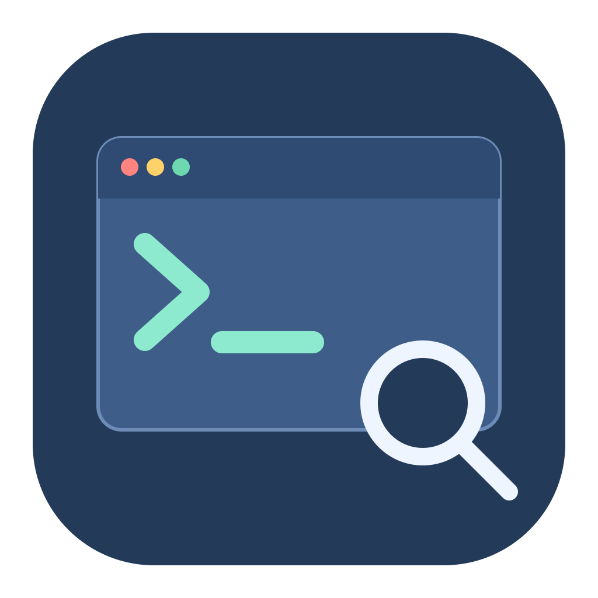
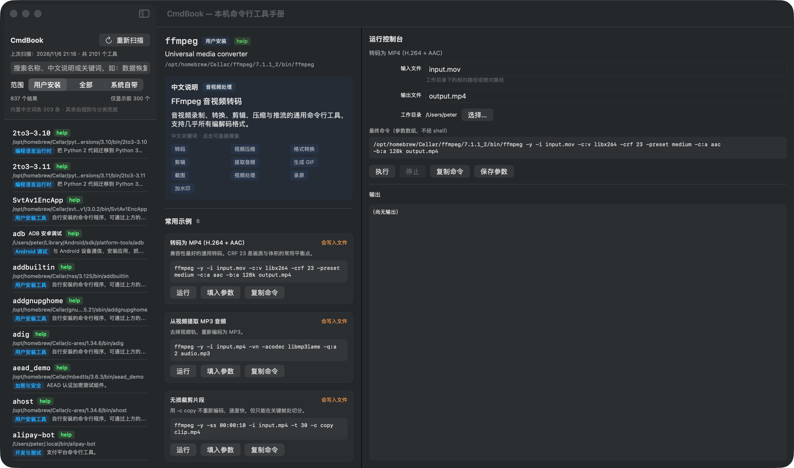

# CmdBook — macOS 原生命令行工具手册

扫描本机 `PATH` 上的命令行工具，生成带**中文说明**的可搜索索引，并提供可直接执行的常用示例。
纯 Swift（SwiftUI + AppKit）：无 WebView、无本地服务器、无第三方依赖、全程离线、零网络请求。





## 特性

- **发现**：解析登录 shell 的真实 PATH（含 `/etc/paths.d/homebrew`），按 basename 去重，
  标记为「用户安装 / 系统自带 / 运行时附带」，默认只展示用户安装的工具。
- **中文可搜索**：内置中文词典 + 名称规则 + 分类兜底，每个工具都有中文说明、中文分类与中文关键词。
  搜索 `数据恢复` 会命中 `photorec` / `testdisk` / `fidentify`；搜索 `转码` 命中 `ffmpeg`。
- **用法查询**：依次尝试 `--help` → `man -P cat` → `whatis`，清理 ANSI 与 man 重字符，
  提取描述与 `EXAMPLES` 段；另内置 38 条精选示例，覆盖 17 个常用工具
  （ffmpeg、ffprobe、photorec、testdisk、rg、jq、yt-dlp、curl、tar、find、git、magick 等）。
- **安全执行**：白名单式。示例是 `argv` 模板 + 可编辑字段表单，占位符只在单个参数内替换，
  **绝不构造 shell 字符串**；执行前二次确认、流式输出、可停止、60 秒超时、回显退出码。
  交互式 TUI（photorec / top / ssh 等）自动转交 Terminal.app。
- **原生形态**：SwiftUI 三栏窗口、原生菜单与快捷键、自绘 `.icns` 图标、ad-hoc 签名。

## 环境要求

| 项目 | 要求 |
|------|------|
| 系统 | macOS 13+（Apple Silicon，`arm64-apple-macosx13.0`） |
| 工具链 | Xcode Command Line Tools（`swiftc`、`sips`、`iconutil`、`codesign`） |
| 完整 Xcode | **不需要**，但做 Developer ID 公证时需要 |
| 语言 | Swift 5 模式，Node/Python/Rust 均不需要 |

检查工具链：

```sh
xcode-select -p
swift --version
```

## 从源码构建与运行

```sh
git clone <your-repo-url> command
cd command
./build.sh                  # 编译并组包，图标缺失时会自动调用 make-icon.sh
open dist/CmdBook.app       # 启动
```

`build.sh` 做四件事：用 `swiftc` 编译 `Sources/*.swift`、复制 `Info.plist` 与
`examples.json` / `tool-zh.json` / `CmdBook.icns` 到 `.app` 包、写 `PkgInfo`、
执行 `codesign -s -` 临时签名。

首次启动会自动扫描一次；之后用「重新扫描」按钮或 `⌘R` 更新索引。
`⌘F` 聚焦搜索，`Esc` 清空查询，方向键移动选择。左侧可在
「用户安装 / 全部 / 系统自带」间切换。

## 中文说明体系

词典位于 `Resources/tool-zh.json`，三层结构：

```json
{
  "version": 1,
  "tools": {
    "photorec": {
      "title": "PhotoRec 文件恢复",
      "summary": "按文件头特征扫描磁盘……",
      "category": "数据恢复与磁盘",
      "keywords": ["数据恢复", "文件恢复", "误删恢复", "找回文件"]
    }
  },
  "rules": [
    { "prefix": "git-", "category": "版本控制", "keywords": ["版本管理"], "summary": "Git 子命令。" }
  ],
  "fallback": {
    "user":    { "title": "", "summary": "自行安装的命令行程序……", "category": "用户安装工具", "keywords": [] },
    "system":  { "title": "", "summary": "macOS 系统自带的命令行程序……", "category": "macOS 系统自带", "keywords": [] },
    "runtime": { "title": "", "summary": "由其他应用程序附带的命令行组件……", "category": "应用运行时附带", "keywords": [] }
  }
}
```

- `tools`：精确词条（当前 221 条），优先级最高。
- `rules`：按名称前缀匹配的规则（当前 215 条），覆盖 PostgreSQL / PDF / WebP / JPEG XL /
  OpenEXR / TIFF / 压缩格式 / 大模型 / OCR / 密码学 / FFmpeg 等工具族。
- `fallback`：按来源分类兜底，并附上英文说明，保证**所有工具都有可读中文说明与分类**。

在本机 837 个用户安装工具中，142 个有精确词条、546 个命中规则、其余 149 个
（多为第三方库自带的测试程序）使用分类兜底；2101 个工具 **100% 具备中文说明与中文分类**。
若当前筛选范围内没有命中，应用会自动扩大到全部工具并在侧栏提示。

**扩充中文说明**：直接编辑 `Resources/tool-zh.json` 的 `tools` 字典即可，不需要改 Swift 代码、
不需要重新编译；重启应用会重新套用词典。若要把中文一并写入快照文件，再执行一次 `--scan`。

**搜索排序**（`Sources/Search.swift`，纯函数、可单测）：
中文关键词精确命中 > 中文名称/分类命中 > 关键词子串 > 英文名称前缀/子串 >
中文说明 > 路径 > 英文描述 > 用法文本。因此中文查询会稳定排在最前。
详情页的中文关键词标签可点击，直接作为搜索词。

## 工程结构

```
Sources/
  main.swift            入口；含 --scan / --verify / --runprobe 无界面模式
  AppDelegate.swift     NSApplication 生命周期、主菜单与快捷键
  AppModel.swift        状态、中文词典套用、筛选、扫描调度、执行编排
  ContentView.swift     SwiftUI 三栏界面（列表 / 详情 / 运行控制台）
  Models.swift          数据模型（含向后兼容的解码器）
  Paths.swift           应用目录、资源定位、来源分类、交互/危险工具名单
  ChineseNotes.swift    中文词典载入与三层说明生成
  Search.swift          纯函数中文优先搜索排序
  ProcessSupport.swift  子进程封装（临时文件捕获 + 硬超时 + 独立 CWD）、登录 PATH 解析
  Scanner.swift         PATH 发现、并发用法探测、中文说明写入快照
  TextCleanup.swift     ANSI/重字符清理、规范化、描述与 EXAMPLES 提取
  ExampleRepo.swift     内置示例库载入
  Runner.swift          白名单执行器、流式输出、Terminal 转交
  Store.swift           快照与保存项读写（原子写入）
  Headless.swift        无界面扫描、自检、中文搜索回归
Scripts/
  MakeIcon.swift        Core Graphics 自绘 1024×1024 图标
Resources/
  Info.plist            .app 包元数据（含 CFBundleIconFile）
  examples.json         内置精选示例库（38 条 / 17 工具）
  tool-zh.json          中文元数据词典
  CmdBook.icns          生成好的应用图标（提交进仓库，clone 后无需重画）
build.sh                swiftc 编译 + 组包 + ad-hoc 签名
make-icon.sh            重新生成 CmdBook.icns
docs/plans/2026-11-06-macos-cli-catalog-design.md   现行设计文档
docs/cmdbook-preview.png                             界面预览图
```

## 数据与验证

运行时数据（不在仓库内）：

```
~/Library/Application Support/CmdBook/tools.json    # 扫描快照
~/Library/Application Support/CmdBook/saved.json    # 保存的参数组合
```

无界面命令（`BIN=dist/CmdBook.app/Contents/MacOS/CmdBook`）：

```sh
$BIN --verify                # 27 项自检，含中文搜索与工作目录隔离回归
$BIN --runprobe              # 流式执行器端到端验证
$BIN --scan                  # 全量扫描并写入快照
$BIN --scan --limit 50       # 限量扫描（调试）
$BIN --search 数据恢复       # 对真实快照做中文检索（输出前 10 条）
$BIN --search 转码
```

`--verify` 覆盖：示例库载入、占位符展开、危险/交互工具拦截、进程执行与输出捕获、
探测子进程不污染工作区、man 重字符清理、`EXAMPLES` 段提取、PATH 去重、
中文词典与「数据恢复 → photorec」搜索命中、快照编解码。

## 打包与分发

### 1. 本地 ad-hoc 构建（默认）

```sh
./build.sh
/usr/bin/codesign -dv dist/CmdBook.app     # 确认 Signature=adhoc
open dist/CmdBook.app
```

此构建只能在本机顺畅使用，换机可能被 Gatekeeper 拦截。

### 2. 重新生成图标

```sh
./make-icon.sh              # 从 Scripts/MakeIcon.swift 重画并生成 Resources/CmdBook.icns
./build.sh                  # 重新组包
```

脚本用 `swiftc` 画 1024×1024 主图，用 `sips` 生成 iconset 各尺寸，
再用 `iconutil -c icns` 合成；不依赖任何设计工具或图片素材。

### 3. 生成分发包

zip（保留代码签名与扩展属性）：

```sh
ditto -c -k --sequesterRsrc --keepParent dist/CmdBook.app dist/CmdBook.zip
```

dmg（带 Applications 快捷方式，用户拖入即可安装）：

```sh
mkdir -p dist/dmg
cp -R dist/CmdBook.app dist/dmg/
ln -s /Applications dist/dmg/Applications
hdiutil create -volname "CmdBook" -srcfolder dist/dmg -ov -format UDZO dist/CmdBook.dmg
```

### 4. Developer ID 签名与公证（对外正式分发）

需要 Apple Developer 账号与**完整 Xcode**（`notarytool` 依赖 Xcode 工具链）：

```sh
# 用 Developer ID 替换 ad-hoc 签名，并启用 hardened runtime
codesign --force --deep --options runtime --timestamp \
  -s "Developer ID Application: <姓名> (<TEAMID>)" dist/CmdBook.app
spctl -a -vv dist/CmdBook.app

# 公证（用 App 专用密码或 --keychain-profile）
ditto -c -k --keepParent dist/CmdBook.app dist/CmdBook.zip
xcrun notarytool submit dist/CmdBook.zip \
  --apple-id "<Apple ID>" --team-id "<TEAMID>" --password "<app-specific-password>" --wait
xcrun stapler staple dist/CmdBook.app
```

未经公证的 ad-hoc 包，用户首次打开可右键「打开」，或本机执行：

```sh
xattr -cr dist/CmdBook.app
```

### 5. 更新版本号

编辑 `Resources/Info.plist` 的 `CFBundleShortVersionString` 与 `CFBundleVersion`，
然后重新执行 `./build.sh`。

## 推送远程仓库

`.gitignore` 已排除构建产物、图标中间文件、运行时快照与密钥类文件。推送前建议：

```sh
git status --short                 # 确认没有 dist/、.build/、.DS_Store、密钥文件
git add .
git commit -m "feat: CmdBook macOS 原生命令行工具手册"
git remote add origin git@github.com:<user>/<repo>.git   # 或 https 地址
git push -u origin main
```

**注意**：本仓库不含任何硬编码凭证；若将来为公证配置 App 专用密码，请用
`xcrun notarytool store-credentials` 存进钥匙串或环境变量，切勿写入文件。

## 安全约束

- 所有子进程以参数数组调用，从不使用 `sh -c`；`rm` / `sudo` / `dd` / `diskutil` /
  shell 等危险工具直接拒绝执行。
- 探测阶段每个进程使用**独立临时工作目录**（结束后清理），避免 CLI 在被探测时
  向工作区写配置或缓存；应用包内的 `runtime` 二进制一律不执行 `--help`。
- 探测硬约束：单进程 1.5 秒 `SIGKILL`、并发 12、捕获上限 256 KiB、全局软超时 180 秒。
- 快照原子写入，中断不会破坏上一份好数据。
- GUI 进程不继承 shell PATH，执行时使用工具绝对路径并显式注入扫描时记录的 PATH。

## 已知限制

- 采用 `swiftc` 手工组包而非 Xcode 工程，无 SwiftUI 预览与 Interface Builder；
  界面细节靠运行观察调整。
- 仅 macOS 13+ / Apple Silicon；Intel Mac 需把 `build.sh` 的 `-target` 改为
  `x86_64-apple-macosx13.0`（或产出 universal 二进制）。
- 中文词典为人工维护的常用词表，冷门系统命令使用规则/分类兜底说明，
  详情仍以原始英文用法文本为准。
- `man` 的 `EXAMPLES` 段并非所有工具都有，内置示例库是主力数据源。

## 旧文件

`index.html`、`css/`、`js/`、`tests/`、`docs/design.md`、
`docs/superpowers/plans/` 来自此前的 DevOps 监控面板示例与已废弃的网页方案，
与 CmdBook 无关，暂作历史记录保留，确认后可清理。
